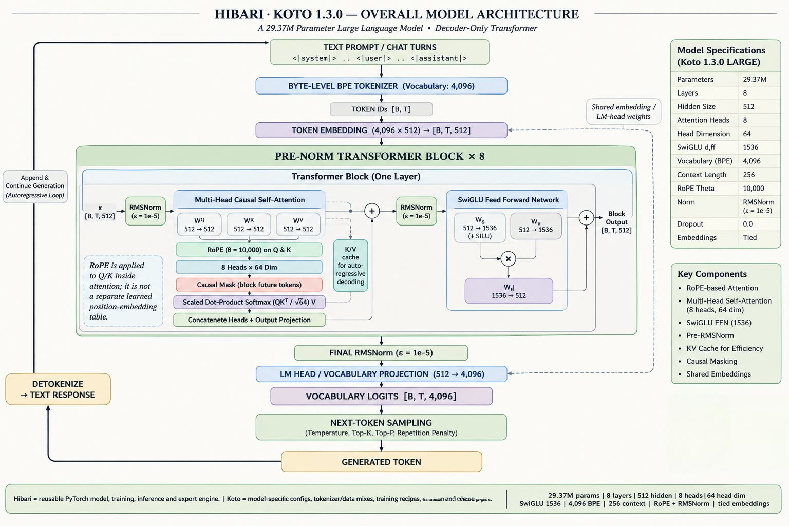
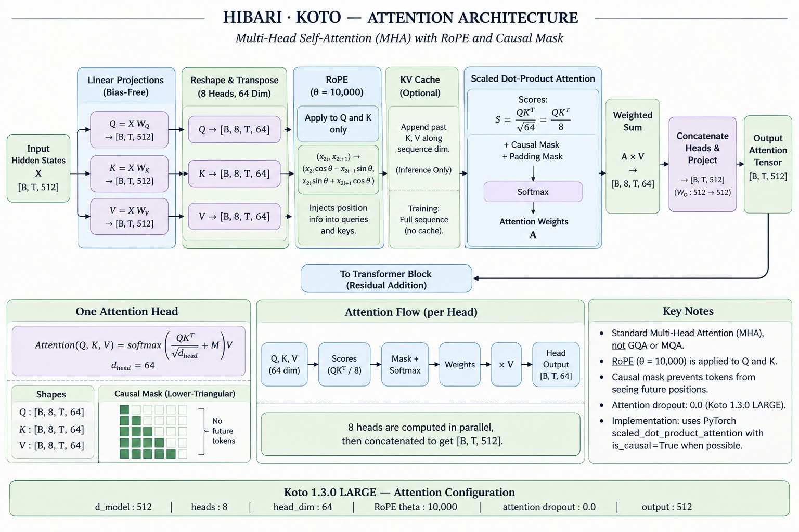
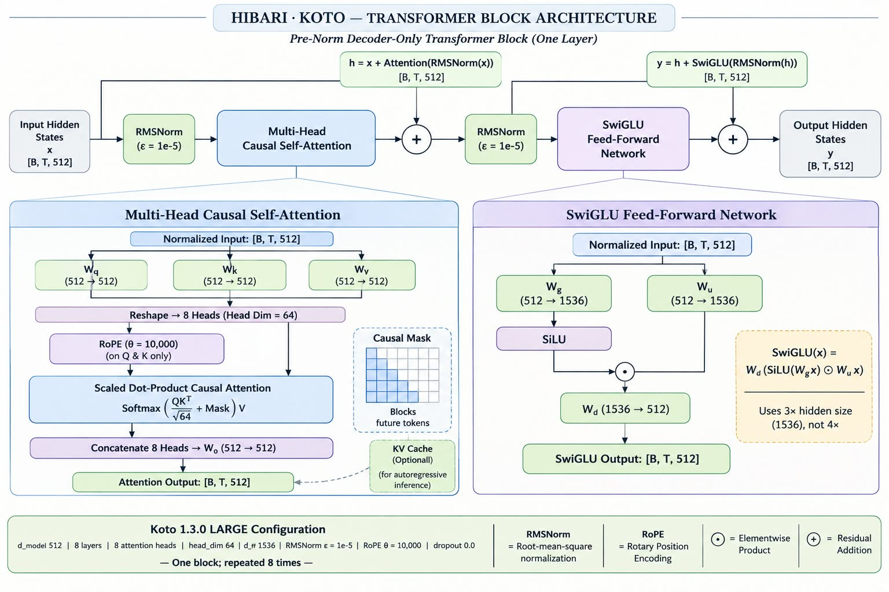
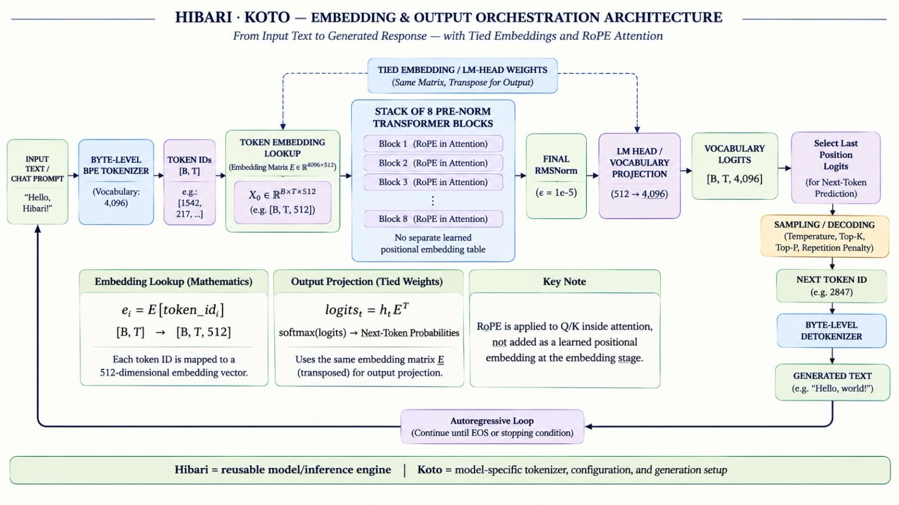

<div align="center">


# Hibari

**A Purpose-Built Cognitive LLM Architecture & Language Model Built from Scratch**

Author: **[Kavimugil Rajasekar](https://kavimugilrajasekar.github.io)**  
[GitHub](https://github.com/KavimugilRajasekar) | [Portfolio](https://kavimugilrajasekar.github.io) | [Repository](https://github.com/KavimugilRajasekar/Hibari)

</div>

---

## Overview

**Hibari** is the name of the overarching cognitive Large Language Model (LLM) architecture and research project being engineered entirely from the ground up in pure PyTorch.

Rather than fine-tuning pre-existing weights or relying on high-level prebuilt model wrappers, Hibari is implemented from foundational mathematical principles. Every core component—from Rotary Position Embeddings (RoPE), Root Mean Square Normalization (RMSNorm), and SwiGLU feed-forward networks to custom Byte-Pair Encoding (BPE), autoregressive inference engines, and native binary GGUF export—is written directly.

**Hibari Koto** (`Hibari-Koto`) is the first conversational model developed and trained under the Hibari architecture. Built for friendly, empathetic dialogue and simple writing help, it has 6.16M parameters, a 4,096-token byte-level BPE vocabulary, and is trained with supervised fine-tuning (SFT) loss masking on a blend of open conversation, writing-task and hand-written datasets.

The project is split into two Git repositories:

- **Hibari** (this repository) — the engine: the `hibari` Python package, engine scripts, tests and engine documentation.
- **Koto** (`models/Koto`, a Git submodule) — everything specific to the Koto model: configs, tokenizer, data builders, training and evaluation scripts, checkpoints and model documentation.

---

## Model Specifications: Hibari Koto (`Hibari-Koto`)

| Specification | Hibari Koto | Technical Context |
|---|---|---|
| Parent Architecture | Hibari | Decoder-only causal Transformer (LLaMA-style) |
| Model Identifier | `Hibari-Koto` | Friendly conversation and writing help |
| Trainable Parameters | **6,163,712 (~6.16 Million)** | Trains and runs on a CPU |
| Hidden Dimension (d_model) | **256** | Activation width per layer |
| Transformer Layers | **6** | Stacked causal Transformer blocks |
| Attention Heads | **8** | Head dimension = 32, full multi-head (no grouped KV) |
| Feed-Forward Network | **SwiGLU (d_ff = 768)** | 3x expansion with Swish gating |
| Position Encoding | RoPE (theta = 10,000.0) | Adjacent-pair rotation (llama.cpp `ROPE_TYPE_NORM`) |
| Normalization | Pre-RMSNorm (eps = 1e-5) | Scale-invariant layer normalization |
| Vocabulary Size | **4,096 tokens** | Byte-level BPE with 7 chat special tokens |
| Max Context Window | **256 tokens** | Includes the system prompt, history and the reply |
| Weight Tying | Enabled | `lm_head` shares the token embedding matrix |
| Training Objective | **SFT target masking (`targets = -100`)** | Loss on assistant tokens only |
| Training Data (1.1.0 mix) | **108,850 training conversations** | Open dialogue corpora, writing-task corpora and hand-written Koto data — see [Dataset Catalog](models/Koto/docs/16_DATASET_CATALOG.md) |
| Validation Perplexity (open conversation) | **20.86** (1.0.0) / 22.39 (1.1.0) | Same held-out split for both; lower is better |
| Behaviour Suite Pass Rate | 16.7 % (1.0.0) / **53.7 %** (1.1.0) | 54 held-out cases, routed, greedy — see [Development Report](models/Koto/docs/19_KOTO_1.1.0_DEVELOPMENT_REPORT.md) |
| Export Formats | **GGUF: F32, F16, Q8_0, Q4_K_M** | llama.cpp and Ollama (output parity verified against PyTorch) |
| GGUF File Size | **24.8 MB (F32) / 12.5 MB (F16) / 6.7 MB (Q8_0) / 4.0 MB (Q4_K_M)** | Small enough for any laptop |

> **1.1.1** (`configs/release/koto_1.1.1.yaml`) is the current release candidate: the 1.1.0
> weights with the 0.3.0 conversational layer. **1.0.0** is `checkpoints/koto_start`. **1.1.0**
> (`checkpoints/koto_1.1.0`) was trained and evaluated:
> much better at grammar correction and rewriting, somewhat better at
> multi-turn dialogue, slightly worse at open chit-chat, and it still
> invents facts. GGUF files exist for 1.0.0 only.

---

## How the Project Is Organised

Hibari is built as **two layers that live in two Git repositories**:

| Layer | Repository | What it is | Knows about the other? |
|---|---|---|---|
| **Engine** | `Hibari` (this repo) | A reusable, model-agnostic Python package (`hibari`) that can build, train, run, evaluate and export *any* model of this architecture | **No.** The engine never imports Koto. |
| **Model** | `Koto` (`models/Koto`, Git submodule) | One concrete model: its configs, tokenizer, data recipes, training runs, evaluation suites, checkpoints and release files | **Yes.** Koto imports `hibari` and only *uses* it. |

The dependency goes one way only, **Koto → Hibari**. Because of that, a
second model (for example a larger "Koto-M" or a new model) can be added as
another submodule under `models/` without changing the engine, and an engine
improvement reaches every model at once.

### Inside the engine: one package per responsibility

```
                         ┌──────────────────────────── hibari (engine) ────────────────────────────┐
                         │                                                                          │
 raw text ─▶ data ───────┼─▶ tokenizer · chat template · dataset (SFT masking) · collator           │
                         │        │                                                                 │
                         │        ▼                                                                 │
                         │   model ─────── ModelConfig · RoPE · attention + KV cache · RMSNorm ·    │
                         │        │        SwiGLU · HibariKotoLM                                    │
                         │        ▼                                                                 │
                         │   training ──── Trainer · AdamW · cosine schedule · checkpoints          │
                         │        │                                                                 │
                         │        ▼                                                                 │
 user message ───────────┼─▶ inference ─── safety layer ─▶ task router ─▶ chat session ─▶ sampling   │──▶ reply
                         │        │                                                                 │
                         │        ├─▶ evaluation ── response metrics (repetition, chrF, echo, …)    │
                         │        └─▶ export ────── GGUF writer / reader ──────────────────────────┼──▶ llama.cpp / Ollama
                         └──────────────────────────────────────────────────────────────────────────┘
```

| Package | Responsibility | Depends on |
|---|---|---|
| `hibari.model` | The neural network only — no data, no training, no I/O | `torch` |
| `hibari.data` | Turning text into training tensors and the chat template | `model` (config only), `tokenizers` |
| `hibari.training` | Optimisation loop, schedules, checkpoint files | `model`, `data` |
| `hibari.inference` | Everything at chat time: safety, task routing, history, decoding | `model`, `data` |
| `hibari.evaluation` | Model-independent scoring of generated text | nothing (pure Python) |
| `hibari.export` | Converting checkpoints to GGUF and reading them back | `model`, `data`, `gguf` |
| `hibari.memory`, `hibari.personality`, `hibari.utils` | Reserved for planned features (placeholders) | — |

### Inside Koto: the model's recipe

```
configs/  ──▶  scripts/prepare_data.py ──▶ data/processed/        (download corpora, train tokenizer)
                       │
koto/data/* ─▶ scripts/build_mix.py ──────▶ data/processed_1.1.0/  (mix + filter + split, no downloads)
                       │
               training/train.py ─────────▶ checkpoints/<run>/     (uses hibari.training)
                       │
               evaluation/evaluate_upgrade.py ─▶ outputs/evaluation/ (uses hibari.inference + koto.evaluation)
                       │
               ../../scripts/engine/export.py ─▶ releases/exported/*.gguf ─▶ Ollama
```

---

## Detailed Project Structure

Legend: **[placeholder]** = file exists but is not implemented yet ·
**[local]** = exists only on your machine, never committed ·
numbers in `( )` are lines of code.

```
Hibari/                                          ══ ENGINE REPOSITORY ══
│
├── README.md                                    This file: overview, architecture, structure, quick start
├── CONTRIBUTING.md                              Branching, commit and test workflow
├── LICENSE                                      MIT License
├── pyproject.toml                               Package `hibari` 0.2.0; dependencies; pytest / black / ruff settings
├── .gitignore                                   Ignores weights, GGUFs, data, logs, venvs
├── .gitmodules                                  Registers models/Koto as a submodule
├── hibari.jpeg                                  Project logo
│
├── src/hibari/                                  ── THE ENGINE PACKAGE ──
│   ├── __init__.py                     (23)     Package version and top-level exports
│   ├── __main__.py                      (7)     `python -m hibari` entry point
│   │
│   ├── model/                                   Neural network architecture
│   │   ├── config.py                   (75)     ModelConfig dataclass, YAML load/save, parameter estimate
│   │   ├── embedding.py                (66)     Token embedding; RoPE frequency tables and rotation
│   │   ├── attention.py               (116)     Multi-head causal attention, KV cache, SDPA fast path
│   │   ├── normalization.py            (20)     RMSNorm (computed in fp32)
│   │   ├── transformer.py              (65)     SwiGLU FFN and the pre-norm Transformer block
│   │   └── llm.py                     (205)     HibariKotoLM: embeddings → N blocks → norm → tied LM head
│   │
│   ├── data/                                    Text → training tensors
│   │   ├── tokenizer.py               (161)     Byte-level BPE (train/load/save), special tokens, chat template
│   │   ├── formatting.py              (221)     Per-corpus formatters, text cleaning, default system prompt
│   │   ├── dataset.py                 (121)     ConversationDataset with SFT loss masking (assistant-only loss)
│   │   ├── collator.py                 (81)     Right-padding collator; length-grouped batch sampler
│   │   └── preprocessing.py             (1)     [placeholder]
│   │
│   ├── training/                                Optimisation
│   │   ├── trainer.py                 (244)     Training loop: eval, early stopping, time limit, grad accumulation
│   │   ├── optimizer.py                (35)     AdamW with weight decay on matrices only
│   │   ├── scheduler.py                (26)     Linear warmup + cosine decay
│   │   ├── loss.py                     (30)     Causal LM loss, perplexity
│   │   ├── checkpoint.py               (70)     Save / safe-load checkpoints (weights_only=True)
│   │   └── fine_tuning.py               (1)     [placeholder] LoRA (planned)
│   │
│   ├── inference/                               Chat-time pipeline
│   │   ├── engine.py                   (79)     InferenceEngine: from_checkpoint, chat sessions, rewrite, generate
│   │   ├── conversation.py            (311)     HibariChatSession: history trimming, safety, task routing, cleanup
│   │   ├── generation.py              (138)     KV-cached autoregressive decoding, stop tokens, context budget
│   │   ├── sampling.py                 (90)     Temperature, top-k, top-p, repetition penalty, n-gram blocking
│   │   ├── safety.py                  (295)     Rule-based self-harm / violence / harmful-request layer
│   │   └── tasks.py                   (204)     Rewriting tasks: canonical format, request parser, term checks
│   │
│   ├── evaluation/
│   │   ├── metrics.py                 (120)     Repetition, distinct-n, chrF, echo, length, lead / disclaimer checks
│   │   ├── evaluator.py                 (1)     [placeholder]
│   │   └── benchmarks.py                (1)     [placeholder]
│   │
│   ├── export/
│   │   ├── gguf_export.py             (218)     Checkpoint → self-contained GGUF (llama architecture, F32/F16)
│   │   ├── gguf_reference.py          (104)     NumPy reference runtime that runs a GGUF for parity tests
│   │   ├── quantization.py             (28)     FP16 conversion, size statistics
│   │   └── checkpoint_export.py         (1)     [placeholder]
│   │
│   ├── memory/            context.py · retrieval.py · store.py           [placeholder] long-term memory (planned)
│   ├── personality/       profile.py · instructions.py · safety.py       [placeholder] persona profiles (planned)
│   └── utils/             config.py · device.py · logging.py · reproducibility.py   [placeholder]
│
├── scripts/engine/                              ── ENGINE TOOLS (run from the Hibari root) ──
│   ├── generate.py                     (88)     Interactive chat or one reply (--prompt)
│   ├── export.py                      (118)     Export F32 / F16, then Q8_0 / Q4_K_M via llama-quantize
│   ├── verify_gguf.py                 (241)     GGUF vs PyTorch: metadata, tokenizer and greedy-output parity
│   ├── verify_llama_cpp_python.py      (65)     Same parity check through llama-cpp-python
│   └── benchmark.py                   (140)     Tokens/second for PyTorch and GGUF variants
│
├── tests/                                       ── ENGINE TESTS (pytest, 247 tests) ──
│   ├── conftest.py                     (14)     Shared fixtures
│   ├── test_model.py                  (163)     Shapes, parameter count, causality, KV-cache parity
│   ├── test_tokenizer.py               (37)     BPE training, encoding, chat template
│   ├── test_dataset.py                (133)     Formatting, SFT masking, collator
│   ├── test_training.py               (172)     Loss masking, optimisation, eval, checkpoints
│   ├── test_inference.py              (274)     Sampling, generation, EOS, context, chat sessions, safety
│   ├── test_tasks.py                  (239)     Task format, request parsing, term preservation, chunking
│   ├── test_metrics.py                 (88)     Metrics; gradient accumulation equivalence
│   ├── test_export.py                  (31)     GGUF header basics
│   ├── test_gguf_export_comprehensive.py (689)  Full GGUF structure, tokenizer and reference-runtime parity
│   ├── test_regressions.py                      One test per bug fixed in the 2026-11 review
│   └── test_architecture_invariants.py          Causality, KV cache, RoPE, GGUF reference runtime, runtime paths
│
├── hibari/configs/                              Engine base templates: model/ training/ (base, sft) data/ inference/
│
├── Docs/                                        ── ENGINE DOCUMENTATION ──
│   ├── README.md                                Index of all docs (engine + Koto)
│   ├── engine/                                  01 Overview · 02 Goals · 10 Inference · 11 Memory · 12 Export
│   │                                            26 Conversational layer · 27 Release profiles and provenance
│   ├── architecture/                            03 System architecture · 04 Model design · 06 Tokenizer design
│   │                                            34 GPT-2 reference
│   ├── decisions/                               ADRs 0001–0005 (PyTorch, from scratch, GGUF, multi-dataset, writing help)
│   ├── template/                                21–25 Development template, lifecycle, standards, task templates, checklist
│   ├── assets/                                  Architecture diagrams (overall, transformer block, attention, embedding/output)
│   ├── 15_API_AND_CLI_REFERENCE.md              Every script flag and the Python API
│   └── 20_CHANGELOG.md                          Engine changelog
│
└── models/Koto/                                 ══ KOTO MODEL REPOSITORY (submodule) ══
    ├── README.md · MODEL_CARD.md · CHANGELOG.md · LICENSE
    │
    ├── configs/
    │   ├── model/koto.yaml                      Architecture (6 layers, d_model 256, 8 heads, 4,096 vocab)
    │   ├── data/koto.yaml                       Corpus download + tokenizer settings (prepare_data.py)
    │   ├── data/koto_1.1.0.yaml                 The 1.1.0 training mix (build_mix.py)
    │   ├── training/koto.yaml                   1.0.0 full run
    │   ├── training/koto_continue.yaml          1.0.0 continuation
    │   ├── training/koto_1.1.0.yaml             1.1.0 full run from scratch (12k steps, max 6 h)
    │   ├── training/koto_1.1.0_ft.yaml          1.1.0 as a fine-tune of 1.0.0
    │   └── inference/koto.yaml                  Sampling defaults
    │
    ├── tokenizer/                               tokenizer.json, tokenizer_config.json (4,096 tokens)
    │
    ├── koto/                                    ── KOTO PYTHON PACKAGE ──
    │   ├── __init__.py                 (22)     Makes the engine importable from the submodule checkout
    │   ├── paths.py                    (24)     Default folders; resolves relative paths against the Koto root
    │   ├── data/
    │   │   ├── curated.py             (626)     Identity, personality, hostility and safety conversations
    │   │   ├── conversation.py        (387)     Small talk, explanations, multi-turn learning / problem chains
    │   │   ├── dialogue_skills.py     (417)     Context recall, clarification, honest limits, chat vs correction
    │   │   ├── tasks.py               (668)     Rewriting-task data in the canonical task format
    │   │   └── rewrite.py             (297)     CoEdIT, ParaDetox, smol-rewrite loaders; polite set; emails
    │   └── evaluation/
    │       ├── suite.py               (180)     Legacy held-out suite (58 cases) and scoring helpers
    │       └── upgrade_suite.py       (345)     1.1.0 suite: conversation, context, rewriting, robustness
    │
    ├── scripts/
    │   ├── prepare_data.py            (290)     Download corpora, clean, de-duplicate, train tokenizer
    │   ├── build_mix.py               (308)     Build a versioned mix: filter eval prompts, hash split, stats
    │   ├── build_finetune_mix.py      (117)     Older v3–v6 fine-tune mixes
    │   └── inject_synthetic_data.py   (277)     Deprecated (v1); kept for history
    │
    ├── training/
    │   ├── train.py                   (305)     Full training or fine-tuning; records run metadata
    │   └── fine_tune.py                (11)     [placeholder]
    │
    ├── evaluation/
    │   ├── evaluate_upgrade.py        (293)     1.1.0 suite report: routed/unrouted, greedy/sampled, stability
    │   └── evaluate.py                (248)     Validation perplexity + legacy suite report
    │
    ├── tests/                                   ── KOTO TESTS (pytest, 59 tests) ──
    │   ├── test_upgrade.py            (218)     1.1.0 data, suite and training entry point
    │   └── test_evaluation.py          (83)     Eval prompts are held out of training; metric helpers
    │
    ├── docs/                                    05 Data · 07 Training · 08 Fine-tuning · 09 Evaluation ·
    │                                            13 Ollama · 14 Configuration · 16 Datasets · 18 Limitations ·
    │                                            19 Koto 1.1.0 development report
    ├── notebooks/                               01 dataset exploration · 02 tokenizer · 03 model · 04 training analysis
    ├── releases/
    │   ├── Modelfile                            Ollama template (chat template, stop tokens, parameters)
    │   └── exported/                            [local] Hibari-Koto-{F32,F16,Q8_0,Q4_K_M}.gguf + Modelfile
    ├── data/                                    [local] raw/ interim/ processed/ processed_1.1.0/ evaluation/
    ├── checkpoints/                             [local] koto_start/ (1.0.0), koto_1.1.0/ (1.1.0), adapters/
    ├── outputs/                                 evaluation/ (reports), metrics/, logs/, samples/
    └── archive/                                 [local] experiment records from before the current start point
```

---

## Structuring Plan

The plan for turning Hibari into a fully structured, release-ready project.
Status reflects the repository as of 2026-11-21.

### Phase A — Consistency (current)
- [x] Engine / model split into two repositories with a one-way dependency (Koto → Hibari)
- [x] Engine tools in `scripts/engine/`; model tools inside Koto
- [x] Documentation split to match the code, with one shared numbering (01–20)
- [x] README, Docs index, CLI reference and script defaults point at the real paths
- [ ] Commit the `feature/koto-1.1.0` work and the Koto submodule changes in logical commits

### Phase B — Packaging
- [ ] Add `tokenizers` to the core dependencies and `gguf` as an `export` extra in `pyproject.toml`
- [ ] Give Koto its own `pyproject.toml` that depends on `hibari`, instead of the path hack in `koto/__init__.py`
- [ ] One command-line entry point per repository (`hibari generate|export|verify`, `koto prepare|build|train|evaluate`)

### Phase C — Quality gates
- [ ] GitHub Actions: run `pytest` and `ruff` on both repositories for every pull request
- [x] Fix the known inference / training issues (special-token injection in user text, token-weighted gradient accumulation, `reset()` keeping a custom system prompt, stop reason, long-message prompt, turn-boundary truncation) — with regression tests
- [ ] Type-check the engine with `mypy`

### Phase D — Clean the placeholders
- [ ] Implement or remove `memory/`, `personality/`, `utils/`, `evaluation/evaluator.py`, `evaluation/benchmarks.py`, `export/checkpoint_export.py`, `data/preprocessing.py`, `training/fine_tuning.py`, Koto `training/fine_tune.py`
- [ ] Mark anything that stays as experimental in its docstring and in this README

### Phase E — Releases
- [ ] One branch per model version (`release/<version>`), tags for released checkpoints
- [ ] Each release ships: GGUF files, Modelfile, evaluation report, model card and changelog entry
- [ ] Host released GGUFs outside Git (e.g. GitHub Releases or Hugging Face) and link them from the model card


---

## Documentation

Documentation is split the same way as the code: **how the engine works**
lives in this repository under `Docs/`, and **how the Koto model is built,
trained and evaluated** lives in the Koto submodule under `models/Koto/docs/`.
Files keep one shared number sequence (01–34) across both places, so a number
always means the same topic.

| Where | What it covers | Files |
|---|---|---|
| `Docs/engine/` | Project scope and the engine's runtime | [01 Project Overview](Docs/engine/01_PROJECT_OVERVIEW.md), [02 Project Goals](Docs/engine/02_PROJECT_GOALS.md), [10 Inference and Generation](Docs/engine/10_INFERENCE_AND_GENERATION.md), [11 Memory and Context](Docs/engine/11_MEMORY_AND_CONTEXT.md), [12 Model Export and Quantization](Docs/engine/12_MODEL_EXPORT_AND_QUANTIZATION.md), [26 Conversational Layer](Docs/engine/26_CONVERSATIONAL_LAYER.md), [27 Release Profiles and Provenance](Docs/engine/27_RELEASE_PROFILES_AND_PROVENANCE.md) |
| `Docs/architecture/` | How the model and tokenizer are designed | [03 System Architecture](Docs/architecture/03_SYSTEM_ARCHITECTURE.md), [04 Model Design](Docs/architecture/04_MODEL_DESIGN.md), [06 Tokenizer Design](Docs/architecture/06_TOKENIZER_DESIGN.md), [34 GPT-2 Reference](Docs/architecture/34_GPT2_REFERENCE.md) |
| `Docs/decisions/` | Architecture Decision Records — *why* things are the way they are | [ADR index](Docs/decisions/README.md) (0001–0005) |
| `Docs/template/` | The official development process | [21 Template](Docs/template/21_DEVELOPMENT_TEMPLATE.md), [22 Lifecycle](Docs/template/22_DEVELOPMENT_LIFECYCLE.md), [23 Engineering Standards](Docs/template/23_ENGINEERING_STANDARDS.md), [24 Task Templates](Docs/template/24_DEVELOPMENT_TEMPLATES.md), [25 Checklist](Docs/template/25_DEVELOPMENT_CHECKLIST.md) |
| `Docs/assets/` | Architecture diagrams | [Asset index](Docs/assets/README.md) |
| `Docs/` (top level) | References and history | [15 API and CLI Reference](Docs/15_API_AND_CLI_REFERENCE.md), [20 Changelog](Docs/20_CHANGELOG.md), [Docs index](Docs/README.md) |
| `models/Koto/docs/` | Koto data, training, evaluation, deployment | [05 Data Pipeline](models/Koto/docs/05_DATA_PIPELINE.md), [07 Training Pipeline](models/Koto/docs/07_TRAINING_PIPELINE.md), [08 Fine-Tuning](models/Koto/docs/08_FINE_TUNING.md), [09 Evaluation and Testing](models/Koto/docs/09_EVALUATION_AND_TESTING.md), [13 Ollama Integration](models/Koto/docs/13_OLLAMA_INTEGRATION.md), [14 Configuration Reference](models/Koto/docs/14_CONFIGURATION_REFERENCE.md), [16 Dataset Catalog](models/Koto/docs/16_DATASET_CATALOG.md), [18 Known Limitations](models/Koto/docs/18_KNOWN_LIMITATIONS.md), [19 Koto 1.1.0 Development Report](models/Koto/docs/19_KOTO_1.1.0_DEVELOPMENT_REPORT.md), [28 Behaviour Specification](models/Koto/docs/28_BEHAVIOUR_SPECIFICATION.md), [29 Data Standards](models/Koto/docs/29_DATA_STANDARDS.md), [30 Model Template](models/Koto/docs/30_KOTO_MODEL_TEMPLATE.md), [31 Koto 1.1.1 Repair Report](models/Koto/docs/31_KOTO_1.1.1_REPAIR_REPORT.md), [32 Koto 1.2.0 Evaluation](models/Koto/docs/32_KOTO_1.2.0_EVALUATION.md), [33 Koto 1.3.0 Development Report](models/Koto/docs/33_KOTO_1.3.0_DEVELOPMENT_REPORT.md) |
| `models/Koto/` (top level) | Model identity and history | [17 Model Card](models/Koto/MODEL_CARD.md), [Koto Changelog](models/Koto/CHANGELOG.md), [Koto README](models/Koto/README.md) |

**Where to put a new document:** a change to the `hibari` package goes in
`Docs/` (engine or architecture); diagrams go in `Docs/assets/` (kebab-case names, listed in its README); a new design decision gets an ADR in
`Docs/decisions/`; anything about Koto's data, training runs, evaluation
results or release goes in `models/Koto/docs/`. Engine changes are logged in
`Docs/20_CHANGELOG.md`, model changes in `models/Koto/CHANGELOG.md`.

---

## Architectural Principles



*Drawn for Koto 1.3.0 (29.4M parameters: d_model 512, 8 layers, 8 heads × 64, d_ff 1536). Koto 1.1.x has the same structure at 6.16M parameters (d_model 256, 6 layers, 8 heads × 32, d_ff 768).*

### 1. Pre-RMSNorm
Standard LayerNorm calculates both the mean and variance across activations, adding unnecessary compute operations. Root Mean Square Normalization preserves scale invariance without mean subtraction:

```
RMSNorm(x) = (x / sqrt(mean(x^2) + epsilon)) * gamma
```

### 2. Rotary Position Embeddings (RoPE)
Instead of adding absolute positional embeddings to token representations, RoPE applies a rotation to pairs of dimensions in query and key vectors proportional to token position. Relative distances between tokens are naturally injected into attention dot products without learned position tables. Hibari rotates adjacent pairs `(x0, x1), (x2, x3), ...`, which is the layout llama.cpp uses for the `llama` architecture, so exported weights need no permutation.

### 3. Multi-Head Causal Self-Attention



Queries, keys, and values are linearly projected across 8 attention heads ($d_k = 32$). A causal mask prevents tokens from attending to later tokens. During generation a KV cache stores past keys and values, so each new token costs one forward step instead of re-running the whole sequence:

```
Attention(Q, K, V) = softmax((Q K^T) / sqrt(d_k) + M_causal) V
```

### 4. SwiGLU Feed-Forward Network



SwiGLU replaces traditional two-layer feed-forward networks with gated linear units driven by the Swish (SiLU) activation function:

```
SwiGLU(x) = (SiLU(x W_gate) * (x W_up)) W_down
```

### 5. Weight Tying



To minimize memory usage and parameter count on edge devices, the output projection matrix (`lm_head.weight`) shares parameters directly with the input embedding table (`embed_tokens.embedding.weight`).

---

## Current Status (2026-11-22)

- Engine **0.3.0**; Koto **1.1.1** = 1.1.0 weights + conversational layer + provenance-checked GGUFs
  (report: `models/Koto/docs/31_KOTO_1.1.1_REPAIR_REPORT.md`).
- Koto **1.2.0** data and configs prepared, not trained (`models/Koto/docs/30_KOTO_MODEL_TEMPLATE.md`).
- Development process: `Docs/template/21_DEVELOPMENT_TEMPLATE.md`.

## Quick Start Guide

### 1. Environment Setup

```bash
git clone --recurse-submodules https://github.com/KavimugilRajasekar/Hibari.git
cd Hibari
python3 -m venv .venv
source .venv/bin/activate
pip install -e ".[dev]"
pip install datasets tokenizers gguf
```

(`tokenizers` is needed by the tokenizer and `gguf` by the exporter; they are
not yet listed in `pyproject.toml`.)

All Koto commands below are run from the Koto folder:

```bash
cd models/Koto
```

### 2. Prepare Data and Tokenizer

Download the conversation corpora, train the BPE tokenizer and cache the general corpus:

```bash
python scripts/prepare_data.py --config configs/data/koto.yaml
```

Build the Koto 1.1.0 training mix (reads the local cache only, no downloads):

```bash
python scripts/build_mix.py --config configs/data/koto_1.1.0.yaml
# add --overwrite to replace an existing data/processed_1.1.0
```

### 3. Train Hibari Koto

```bash
python training/train.py --train-config configs/training/koto_1.1.0.yaml 2>&1 | tee outputs/logs/train_1.1.0.log
```

Checkpoints are written to `checkpoints/koto_1.1.0/` (`best_model.pt`,
`final_model.pt`, `last_checkpoint.pt`, `training_history.json`). The trainer
refuses to overwrite an existing `best_model.pt`.

### 4. Chat with the Model

From the engine root (`cd ../..`). The release profile supplies the checkpoint,
tokenizer, system prompt and every inference setting:

```bash
python scripts/engine/generate.py --profile models/Koto/configs/release/koto_1.1.1.yaml
python scripts/engine/generate.py --profile models/Koto/configs/release/koto_1.1.1.yaml \
  --prompt "Hello, how are you today?" --explain     # shows the reply candidates and scores
python scripts/engine/generate.py --profile ... --raw  # the model alone, as in Ollama
```

### 5. Evaluate

From `models/Koto`:

```bash
python evaluation/evaluate_behaviour.py --profile configs/release/koto_1.1.1.yaml \
  --name koto_1.1.1_behaviour --seeds 0 1 2
python evaluation/evaluate_upgrade.py \
  --checkpoint checkpoints/koto_1.1.0/best_model.pt --name koto_1.1.0 --data-dir data/processed_1.1.0
```

Reports are written to `outputs/evaluation/` (Markdown and JSON).

### 6. Validate, export and compare backends (llama.cpp and Ollama)

From the engine root:

```bash
python scripts/engine/validate_release.py --profile models/Koto/configs/release/koto_1.1.1.yaml
LD_LIBRARY_PATH=~/llama.cpp python scripts/engine/export.py \
  --profile models/Koto/configs/release/koto_1.1.1.yaml \
  --llama-quantize ~/llama.cpp/llama-quantize --record
python scripts/engine/compare_backends.py --profile models/Koto/configs/release/koto_1.1.1.yaml \
  --llama-bin ~/llama.cpp --report models/Koto/outputs/evaluation/backend_parity_1.1.1.json
```

Deploy with Ollama (the Modelfile is generated from the profile):

```bash
cd models/Koto/releases/exported/1.1.1
ollama create hibari-koto:1.1.1 -f Modelfile
ollama run hibari-koto:1.1.1
```

> The older GGUFs directly in `models/Koto/releases/exported/` contain the **1.0.0**
> weights under a stale "koto_v4" label (see that folder's README).

The Python safety layer is **not** part of the GGUF; under Ollama only the
behaviour learned in training applies. See
[13 Ollama Integration](models/Koto/docs/13_OLLAMA_INTEGRATION.md).

### 7. Run the Tests

```bash
pytest                               # engine tests (from the repository root)
cd models/Koto && pytest tests       # Koto tests
```

Current results: **247 passed** (engine) and **59 passed** (Koto).

---

## Project Roadmap

- [x] Phase 1: Machine learning and transformer foundational studies
- [x] Phase 2: From-scratch PyTorch architecture (RoPE, Pre-RMSNorm, SwiGLU, causal MHA, KV cache)
- [x] Phase 3: Byte-level BPE tokenizer training pipeline
- [x] Phase 4: Multi-dataset training pipeline with SFT loss masking
- [x] Phase 5: Hibari Koto 1.0.0 trained and evaluated
- [x] Phase 6: GGUF export (F32, F16, Q8_0, Q4_K_M) with llama.cpp parity verification
- [x] Phase 7: Automated test suites for the engine and Koto
- [ ] Phase 8: Koto 1.1.0 — writing tasks, dialogue skills (trained and evaluated; release pending)
- [ ] Phase 9: LoRA fine-tuning
- [ ] Phase 10: External memory store and retrieval
- [ ] Phase 11: Multi-modal extensions

---

## Author & Contact

- Author: **Kavimugil Rajasekar**
- GitHub: [@KavimugilRajasekar](https://github.com/KavimugilRajasekar)
- Portfolio: [https://kavimugilrajasekar.github.io](https://kavimugilrajasekar.github.io)
- Repository: [https://github.com/KavimugilRajasekar/Hibari](https://github.com/KavimugilRajasekar/Hibari)
